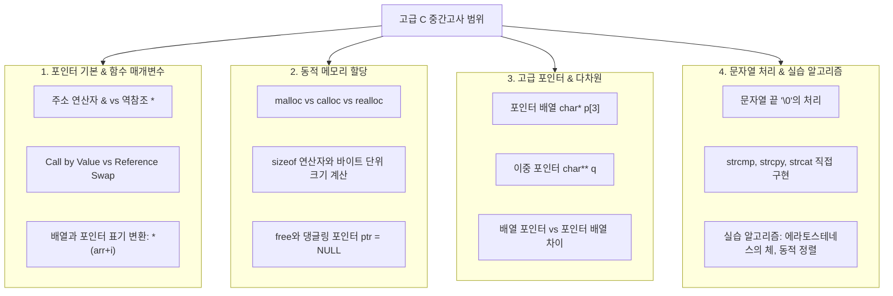

# 🎯 고급 C 프로그래밍 중간고사 완벽 대비 학습 가이드

## 📌 1. 교수님 출제 경향 및 시험 특징 분석

교수님(이우신 교수님)께서 강조하신 출제 포인트는 크게 **"문법을 정확히 이해하고 있는가?"**입니다.
단순히 코드를 외워서 치는 시험이 아니라, C언어의 메모리 모델과 포인터 문법 체계를 명확히 이해하고 있는지를 다음 4가지 형식으로 평가합니다.

| 출제 유형 | 교수님 요구 사항 | 핵심 평가 역량 |
| :--- | :--- | :--- |
| **1. 문법 기술 서술형** | 주어진 문법/개념의 동작 원리와 차이점 기술 | 메모리 구조(스택/힙), 포인터 상수 vs 포인터 변수 차이 명확한 설명력 |
| **2. 문법 O/X 퀴즈** | 코드를 보고 문법적으로 유효한지(컴파일/런타임 에러 여부) 판단 | 문법적 허용 여부, 괄호/연산자 우선순위, 유효하지 않은 포인터 연산 판별 |
| **3. 오류 찾기 및 수정** | 잘못된 코드 줄을 찾아내고, 올바른 문법으로 수정 | `*` 누락, `&` 누락, 배열 포인터 표기 오류, free 후 댕글링 포인터 등 디버깅 역량 |
| **4. 빈칸 채우기** | 코드 중간의 빈칸에 알맞은 C 문법/식 완성 | `malloc/realloc` 인자 계산식, 포인터 역참조 식, 매개변수 선언문 작성 |

---

## 💡 2. 분야별 핵심 시험 범위 맵

중간고사 시험 범위(01강 ~ 05강)는 크게 다음 4개 핵심 영역으로 나뉩니다:

---

## 📝 3. 유형별 고득점 공략법

### ① 문법 기술 서술형
- **키워드 중심 서술**: 단순히 느낌으로 설명하지 말고 컴퓨터 구조/메모리 관점의 전문 용어를 사용합니다.
  - 예: "배열 이름 `arr`은 첫 번째 요소 `arr[0]`의 시작 주소를 가리키는 **수정 불가능한 포인터 상수(r-value)**이므로 `arr++`나 `arr = p`와 같은 대입 연산이 불가능하다."
  - 예: "`free(ptr)`을 호출해도 `ptr`에 저장된 주솟값 자체는 지워지지 않아 여전히 해제된 메모리를 가리키는 **댕글링 포인터(Dangling Pointer)**가 되므로, 안전을 위해 `ptr = NULL;`로 초기화해야 한다."

### ② 문법 O/X 퀴즈
- **컴파일 에러 vs 런타임 에러(UB) 구분**:
  - `int *p; *p = 10;` ➔ 문법적으로 컴파일은 되지만, 초기화되지 않은 쓰레기 주소를 역참조하므로 런타임 에러(Undefined Behavior / Crash).
  - `char *str = "Hello"; str[0] = 'h';` ➔ 문자열 리터럴은 읽기 전용(Code/Text 영역) 메모리이므로 런타임 Crash 발생!
  - `int arr[5]; arr = p;` ➔ 배열 이름은 포인터 상수이므로 **컴파일 에러 (L-value required)**.

### ③ 오류 찾기 및 올바른 문법으로 수정
- **주골격 체크리스트**:
  1. 함수 인자 전달 시 주소 연산자 `&` 누락 여부 확인 (`scanf("%d", num)` ➔ `&num` 필요, 단 포인터나 배열은 `&` 불필요).
  2. 함수 내에서 역참조 `*`를 빼먹고 주소 자체를 바꾸고 있지는 않은가? (`a = b` ➔ `*a = *b`)
  3. `malloc` 크기 계산 시 `sizeof(type)` 곱셈 누락 또는 괄호 위치 오류.
  4. 문자열 동적 할당 시 `\0` (널 문자)를 위한 `+ 1` 공간 누락.
  5. 2차원 동적 할당 해제 시 순서 오류 (바깥을 먼저 해제하면 안쪽 포인터에 접근 불가 메모리 누수 발생).

### ④ 빈칸 채우기
- 교수님 슬라이드 예제에 직접 빈칸이 뚫려 있던 코드들을 100% 숙지해야 합니다:
  - 예제 12-3: `p = (int*) malloc(sizeof(int) * cnt);`
  - 예제 12-3: `scanf("%d", p + i);` (또는 `&p[i]`)
  - 예제 12-3: `hap = hap + *(p + i);` (또는 `hap + p[i]`)
  - 예제 12-5: `p = (int*) realloc(p, sizeof(int) * i);`
  - 예제 12-7: `strcpy(p[i], imsi);` / `free(p[i]);`

---

## 📂 4. 학습 문서 가이드맵

제공되는 파트별 핵심 정리 문서를 다음 순서로 학습하세요:

1. [02_포인터기초_및_함수매개변수.md](file:///d:/광운%202-2/고급c프로그래밍/강의자료/02_포인터기초_및_함수매개변수.md)
2. [03_동적메모리할당_마스터.md](file:///d:/광운%202-2/고급c프로그래밍/강의자료/03_동적메모리할당_마스터.md)
3. [04_고급포인터_포인터배열_이중포인터.md](file:///d:/광운%202-2/고급c프로그래밍/강의자료/04_고급포인터_포인터배열_이중포인터.md)
4. [05_문자열_및_실습알고리즘_구현.md](file:///d:/광운%202-2/고급c프로그래밍/강의자료/05_문자열_및_실습알고리즘_구현.md)
5. [06_중간고사_실전대비_적중모의고사.md](file:///d:/광운%202-2/고급c프로그래밍/강의자료/06_중간고사_실전대비_적중모의고사.md)
