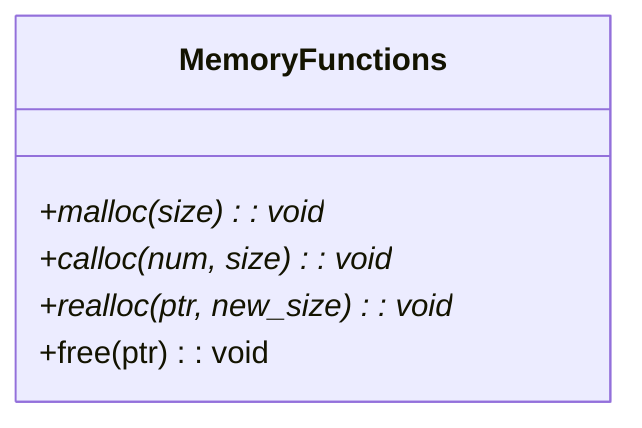

# 💾 Part 2. 동적 메모리 할당 (malloc, calloc, realloc, free) 완벽 마스터

## 1. 동적 메모리 할당의 필요성 (강의자료 예제 12-2)

### (1) 정적 배열 선언의 3대 문제점
```c
int aa[10000]; // 고정 크기 정적 배열
```
1. **메모리 공간 낭비**: 사용자가 데이터를 3개만 입력해도 10,000칸(40,000 바이트)이 미리 할당되어 낭비됨.
2. **메모리 부족 발생**: 사용자가 10,000개 이상의 데이터를 처리하려 할 때 수용 불가능.
3. **프로그램 처리 용량 제한**: 실행 전(컴파일 타임)에 정한 크기를 넘어서는 유연한 대처가 불가능.

### (2) 동적 메모리 할당 (Dynamic Memory Allocation)
- 프로그램 **실행 중(런타임)**에 사용자 입력이나 환경에 맞추어 필요한 만큼의 메모리를 **힙(Heap) 영역**에서 할당받고, 다 쓰면 즉시 반납하는 기법.
- 필수 헤더: `<stdlib.h>` (또는 `<malloc.h>`)

---

## 2. 동적 할당 4대 핵심 함수 비교



| 함수 | 인자 (Arguments) | 초기화 여부 | 주요 용도 |
| :--- | :--- | :---: | :--- |
| **`malloc()`** | 총 바이트 수 (`byte_size`) | ❌ **쓰레기값 유지** | 가장 일반적인 크기 맞춤 동적 할당 |
| **`calloc()`** | 항목 개수(`num`), 단위 크기(`size`) |  **모든 비트를 0으로 초기화** | 초기화가 중요한 카운팅, 플래그 배열 |
| **`realloc()`** | 기존 포인터(`ptr`), 새로운 총 바이트 크기 | 기존 데이터 보존, 확장 영역은 쓰레기값 | 입력 크기가 정해지지 않아 실시간 확장이 필요할 때 |
| **`free()`** | 해제할 힙 메모리 시작 주소(`ptr`) | 반납 후 포인터 변수는 그대로 주소를 가짐 | 메모리 누수(Leak) 방지 |

---

## 3. 함수별 상세 문법 및 빈칸 채우기 공식

### (1) `malloc()`
```c
포인터변수 = (데이터형*) malloc(sizeof(데이터형) * 필요한개수);
```
- **예시**: 정수 100개를 담을 공간 할당
  ```c
  int *p = (int*) malloc(sizeof(int) * 100);
  if (p == NULL) { /* 메모리 할당 실패 처리 */ }
  ```
- **주의점**: 반환형이 `void*`이므로 대상 포인터의 타입에 맞게 명시적 형변환 `(int*)`을 붙여주는 것이 좋습니다.

---

### (2) `calloc()` (Clear Allocation)
```c
포인터변수 = (데이터형*) calloc(필요한개수, sizeof(데이터형));
```
- **예시**:
  ```c
  int *p = (int*) calloc(100, sizeof(int)); // 100개 원소가 모두 0으로 세팅됨
  ```
- `malloc(sizeof(int) * 100)` 후 `memset(p, 0, ...)`을 한 것과 동일한 효과.

---

### (3) `realloc()` (Re-allocation)
```c
포인터변수 = (데이터형*) realloc(기존포인터, sizeof(데이터형) * 새로운총개수);
```
- **실전 패턴 (강의자료 예제 12-5 : 0 입력 전까지 계속 받기)**:
  ```c
  int *p = (int*) malloc(sizeof(int) * 1); // 최초 1개 할당
  int cnt = 1;
  int data;
  
  while (1) {
      scanf("%d", &data);
      if (data == 0) break;
      
      cnt++;
      p = (int*) realloc(p, sizeof(int) * cnt); // 한 칸씩 늘려감
      p[cnt - 1] = data;
  }
  ```
- **동작 원리**:
  1. 기존 위치 뒤에 연속된 여유 공간이 있으면 바로 확장.
  2. 여유 공간이 없으면, **새로운 메모리 영역을 찾아 전체 크기를 새로 할당하고 기존 데이터를 그대로 복사**한 후 기존 블록은 자동 해제함.

---

### (4) `free()`와 댕글링 포인터 (Dangling Pointer) - 🔥 최고 빈출!

교수님 슬라이드 05강 2~3페이지에서 가장 깊이 있게 다룬 주제입니다.

```c
free(ptr);
ptr = NULL; // 👈 왜 반드시 이 줄이 필요한가?
```

#### ❓ 핵심 질문 1: `free(ptr);`를 하면 `ptr`의 값은 어떻게 되는가?
- **답변**: `ptr`이 가리키던 힙 메모리 영역은 운영체제에 반납되지만, **`ptr` 변수 자체에 들어있는 주솟값은 전혀 변경되지 않습니다!**
- 따라서 `free(ptr);` 직후에도 `ptr`은 해제된 메모리 주소를 여전히 가리키고 있는데, 이를 **댕글링 포인터(Dangling Pointer, 허공을 가리키는 포인터)**라고 부릅니다.

#### ❓ 핵심 질문 2: 댕글링 포인터의 위험성은?
1. **값을 읽는 경우**: 다른 프로세스나 다른 함수가 할당받은 엉뚱한 값을 읽어와 논리적 버그 발생.
2. **값을 쓰는 경우 (`*ptr = 10`)**: 이미 해제된 메모리나 다른 용도로 재할당된 영역을 덮어써 프로그램의 비정상 종료(Segmentation Fault / Crash) 또는 심각한 데이터 손상 유발.

#### ❓ 핵심 질문 3: 왜 C언어 `free()`는 스스로 NULL을 넣어주지 못하는가?
- C언어의 함수 호출은 **값에 의한 호출(Call by Value)**입니다.
- `void free(void *ptr);`로 포인터의 "주솟값 복사본"이 전달되므로, 함수 내부에서 매개변수를 아무리 수정해도 호출자의 원본 포인터 변수를 `NULL`로 변경할 수 없습니다! (원본 포인터를 바꾸려면 이중 포인터 `void **`를 넘겨야 함)

---

## 🔍 4. 시험 대비 빈칸 & 오류 찾기 & O/X 체크리스트

### [유형 1: O / X 퀴즈]
1. `free(p);`를 실행하면 포인터 변수 `p`에는 자동으로 `NULL`이 대입된다.
   - **정답: X**
   - **해설**: `free(p)`는 할당된 메모리 공간만 운영체제에 반환할 뿐, `p` 변수에 저장된 주솟값은 그대로 유지됩니다.

2. `int *p = (int*)malloc(10);` 코드는 정수 10개를 저장할 수 있는 공간을 할당한다.
   - **정답: X**
   - **해설**: `malloc`의 인자는 바이트 단위입니다. 10바이트만 할당되므로 4바이트 정수는 2개(8바이트)밖에 온전히 저장하지 못합니다. 정수 10개를 원하면 `sizeof(int) * 10` (즉, 40바이트)을 전달해야 합니다.

3. 동일한 동적 메모리 주소에 대해 `free(p); free(p);`와 같이 연속으로 두 번 해제하는 것은 안전하다.
   - **정답: X**
   - **해설**: 이미 해제된 메모리를 다시 해제하는 것은 **Double Free 오류**로, 프로그램 크래시(Runtime Abort)를 발생시킵니다. (단, `p = NULL;` 처리 후 `free(NULL);`은 아무 일도 하지 않으므로 안전함)

---

### [유형 2: 코드 오류 찾기 및 수정]
**[문제] 사용자가 입력한 `N`개의 정수를 동적 할당하여 합을 구하는 코드이다. 문법적/논리적 오류 3곳을 찾아 수정하시오.**
```c
01 int n, hap = 0;
02 scanf("%d", &n);
03 int *p = malloc(n);
04 for (int i = 0; i < n; i++) {
05     scanf("%d", p[i]);
06     hap += *(p + i);
07 }
08 printf("합: %d\n", hap);
```
- **오류 분석 및 수정**:
  1. **03행**: `malloc(n)` ➔ `malloc(sizeof(int) * n)` (바이트 크기 누락)
  2. **05행**: `scanf("%d", p[i])` ➔ `scanf("%d", &p[i])` 또는 `scanf("%d", p + i)` (`scanf`에는 입력받을 메모리의 '주소'를 넘겨야 함)
  3. **08행 이후**: `free(p); p = NULL;` 누락 (메모리 해제 누수 방지)

---

### [유형 3: 빈칸 완성형 (교수님 강의자료 예제 12-3)]
**[문제] 아래 코드의 빈칸 ①, ②, ③에 알맞은 코드를 작성하시오.**
```c
int *p;
int cnt, hap = 0;
scanf("%d", &cnt);

// ① cnt개의 int 공간 동적 할당
p = (int*) [   ①   ](sizeof(int) * cnt);

// ② 포인터 연산을 이용해 값 입력받기
for(int i = 0; i < cnt; i++) {
    scanf("%d", [   ②   ]);
}

// ③ 누적 합 계산
for(int i = 0; i < cnt; i++) {
    hap = hap + [   ③   ];
}

// ④ 메모리 반납
[   ④   ](p);
```
- **정답**:
  - **①**: `malloc`
  - **②**: `p + i` (또는 `&p[i]`)
  - **③**: `*(p + i)` (또는 `p[i]`)
  - **④**: `free`
