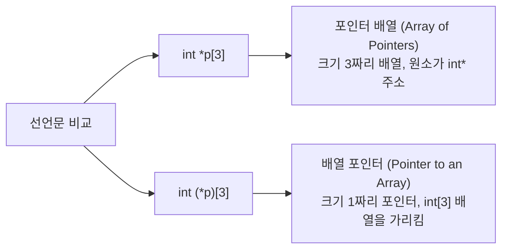

# 🚀 Part 3. 고급 포인터 (포인터 배열, 배열 포인터, 이중 포인터)

## 1. 2차원 배열의 공간 낭비와 포인터 배열의 도입 (예제 12-6)

### (1) 2차원 고정 배열의 문제점
```c
char data[3][100]; // 3개의 문자열을 저장하기 위해 300바이트 고정 할당
```
- 사용자가 `"Basic-C"`, `"Programming"`, `"Study"`를 입력하면 실제 글자 수는 수 바이트에 불과하지만, 행마다 100바이트씩 잡혀 있어 **대부분의 메모리가 낭비 공간**으로 버려집니다.

### (2) 포인터 배열 (Pointer Array)의 해결책 (예제 12-7)
```c
char *p[3]; // 주소(포인터) 3개를 저장할 수 있는 배열 선언
```
- 각 문자열의 실제 길이를 잰 뒤, **딱 그 길이만큼만 동적 할당(`malloc(strlen(str) + 1)`)**하여 주소를 `p[0], p[1], p[2]`에 저장합니다.
- 메모리 공간 낭비를 원천 차단합니다.

---

## 2. ⚡ 시험 1순위: 포인터 배열 vs 배열 포인터

연산자 우선순위 때문에 괄호 `()`의 유무에 따라 완전히 다른 문법이 됩니다.



| 구분 | **포인터 배열** | **배열 포인터** |
| :--- | :--- | :--- |
| **선언 문법** | `int *p[3];` | `int (*p)[3];` |
| **연산자 결합** | `[]`가 `*`보다 우선 결합 (배열이 먼저) | `()`로 묶여 `*`가 먼저 결합 (포인터가 먼저) |
| **본질** | **배열(Array)**이다. (포인터들을 모아둔 배열) | **포인터(Pointer)**이다. (배열 전체를 가리키는 단 1개의 포인터) |
| **메모리 크기** | 포인터 3개 크기 (32비트: 12B, 64비트: 24B) | 포인터 변수 1개 크기 (32비트: 4B, 64비트: 8B) |
| **주요 활용** | 가변 길이 문자열 배열 목록 관리 | 2차원 배열을 함수의 매개변수로 넘길 때 |

---

## 3. 이중 포인터 (Double Pointer: `**`)

### (1) 기본 개념: "포인터 변수의 주소를 저장하는 포인터"
포인터 변수 역시 메모리 어딘가에 할당되므로 고유한 주소가 존재합니다.
```c
char c = 'A';
char *p = &c;   // p는 c의 주소를 저장
char **q = &p;  // q는 p의 주소를 저장
```

```
   q (0x3000)          p (0x2000)          c (0x1000)
+---------------+   +---------------+   +---------------+
|    0x2000     |-->|    0x1000     |-->|      'A'      |
+---------------+   +---------------+   +---------------+
```
- `q` : `p`의 주소 (`&p`)
- `*q` : `p`에 들어있는 값 (즉 `&c`)
- `**q` : `p`가 가리키는 곳의 값 (즉 `c` = `'A'`)

---

### (2) 2차원 가변 동적 할당 (강의자료 05강 6페이지)

사용자로부터 `n`개의 문자열을 입력받되, 문자열의 개수(`n`)와 각 문자열의 길이(`len`)가 모두 가변적일 때 이중 포인터를 사용합니다.

```c
// [1단계] 문자형 포인터(char*)를 n개 담을 수 있는 1차원 포인터 배열 동적 생성
char **q = (char**) malloc(sizeof(char*) * n);

// [2단계] 반복문을 돌며 각 행마다 실제 문자 데이터를 저장할 메모리 공간 동적 할당
for (int i = 0; i < n; i++) {
    q[i] = (char*) malloc(sizeof(char) * (len + 1));
}
```

### (3) 동적 할당 해제 순서 (🔥 시험 함정 빈출!)
반드시 **생성의 역순(안쪽 ➔ 바깥쪽)**으로 해제해야 합니다.
```c
// 1단계: 각 행의 문자열 메모리를 먼저 해제
for (int i = 0; i < n; i++) {
    free(q[i]);
    q[i] = NULL;
}

// 2단계: 포인터들을 담고 있던 메인 포인터 배열 해제
free(q);
q = NULL;
```
> **[치명적 오류 경고]**  
> 만약 `free(q);`를 먼저 실행하면, `q[0] ~ q[n-1]`이 가리키던 실제 데이터들의 주소를 영영 찾을 수 없게 되어 **심각한 메모리 누수(Memory Leak)**가 발생합니다!

---

## 🔍 4. 시험 대비 빈칸 & 오류 찾기 & O/X 체크리스트

### [유형 1: O / X 퀴즈]
1. `int *p[5];`와 `int (*p)[5];`는 문법적으로 완전히 동일한 표현이다.
   - **정답: X**
   - **해설**: `int *p[5]`는 포인터 5개를 원소로 갖는 배열(포인터 배열)이고, `int (*p)[5]`는 크기가 5인 정수형 배열을 가리키는 포인터 1개(배열 포인터)입니다.

2. `char **p;`에서 `sizeof(p)`와 `sizeof(*p)`의 크기는 32비트 시스템에서 모두 4바이트로 동일하다.
   - **정답: O**
   - **해설**: `p`는 이중 포인터(포인터 변수)이므로 4바이트이고, `*p` 역시 `char*` 포인터 변수이므로 4바이트입니다.

3. 포인터 배열로 할당한 메모리를 해제할 때 `free(p);` 한 줄만 실행하면 내부 요소들도 자동으로 해제된다.
   - **정답: X**
   - **해설**: 각 요소 `p[i]`가 `malloc`으로 개별 할당되었으므로, 반드시 루프를 돌며 각 `p[i]`를 먼저 `free`해야 합니다.

---

### [유형 2: 코드 오류 찾기 및 수정 (강의자료 예제 12-7 변형)]
**[문제] 3개의 문자열을 동적으로 입력받아 저장하려는 코드이다. 문법적/런타임 오류가 발생하는 2곳을 찾아 바르게 고치시오.**
```c
01 char *p[3];
02 char imsi[100];
03 for (int i = 0; i < 3; i++) {
04     gets(imsi);
05     p[i] = (char*) malloc(strlen(imsi));
06     strcpy(p, imsi);
07 }
```
- **오류 분석 및 수정**:
  1. **05행**: `malloc(strlen(imsi))` ➔ `malloc(strlen(imsi) + 1)`  
     - 문자열 끝의 **널 문자(`\0`)를 저장할 1바이트 공간**이 누락되었습니다.
  2. **06행**: `strcpy(p, imsi)` ➔ `strcpy(p[i], imsi)`  
     - `p`는 배열 전체의 이름(포인터 상수)이며, 문자열을 복사할 목적지는 `i`번째 포인터 `p[i]`여야 합니다.

---

### [유형 3: 빈칸 완성형]
**[문제] 동적으로 $N$개의 문자열을 다루기 위한 이중 포인터 동적 할당 코드이다. 빈칸을 채우시오.**
```c
int n = 5;
// char* 포인터 5개를 저장할 공간 동적 할당
char **lines = (char**) malloc(sizeof([    ①    ]) * n);

for(int i = 0; i < n; i++) {
    // 각 문자열마다 80글자 + 널문자 공간 할당
    lines[i] = (char*) malloc(sizeof(char) * [    ②    ]);
}
```
- **정답**:
  - **①**: `char*` (포인터를 담아야 하므로)
  - **②**: `81` (또는 `80 + 1`)
